# AuthVote: CI/CD Pipeline and Digital Voting Prototype

**Course report:** CCA 2 — CI/CD with Jenkins, Docker, and Kubernetes
**Repository:** [techie-hrushik027/AuthVote](https://github.com/techie-hrushik027/AuthVote)
**Application image:** `techiehrishi0727/authvote`

## 1. Abstract

AuthVote is a student digital-voting prototype used to demonstrate an end-to-end continuous integration and continuous delivery (CI/CD) workflow. The application presents a voter login and guided voting flow. Jenkins checks out the source, builds and smoke-checks a Docker image, publishes versioned and `latest` tags to Docker Hub, and updates a Kubernetes Deployment running on Minikube.

This report describes both parts of the project: the voting application implemented in the repository and the delivery pipeline used to package and deploy it. The implementation status is based on the source files. Environment-specific Jenkins run results and screenshots should be presented as separate demonstration evidence.

## 2. Project idea and objectives

The application explores how a controlled student election could combine voter eligibility checks, a short identity challenge, candidate selection, and a recorded vote. The academic project also uses the application as a realistic workload for practicing source control, automated builds, container publishing, and Kubernetes rollout.

The project has two related objectives:

1. **Application objective:** provide a prototype flow for student authentication and digital voting, with an election state and database-backed voter and candidate records.
2. **CI/CD objective:** demonstrate how a source revision can move through Jenkins, Docker Hub, and Kubernetes as a repeatable deployment process.

The repository is a prototype and course demonstration. The pipeline's HTTP check verifies that the service's root page responds; it does not by itself establish that every voting workflow or production security requirement has been validated.

## 3. Implemented application

### Voter experience

The FastAPI backend serves the frontend pages and exposes the API routes used by the voting flow. The current source implements:

- **Login:** accepts a student PRN and PIN, checks the election state, compares the PIN with the stored hash, and rejects inactive/locked voters or voters who have already voted.
- **Instructions and rapid-fire identity questions:** the frontend guides a voter through instructions and asks timed questions drawn from profile fields such as date of birth, parent names, blood group, city, and other stored details.
- **Violation reporting:** the frontend reports selected timeout or tab-switch events. The backend increments a violation counter and calls the database revocation procedure when the count reaches its configured threshold.
- **Candidate list and ballot:** candidate information is loaded from the API. The ballot has a time limit and submits the selected candidate to the backend.
- **Vote receipt:** after a successful vote request, the application displays a SHA-256 receipt value returned by the backend.

### Administration and monitoring present in the repository

- The C++ `Admin_Console` provides a local command-line menu for election operations, including starting and ending an election and managing voter/candidate data. It invokes `Backend/admin_tools.py` for database operations.
- `Frontend/dashboard.html` is a browser dashboard that polls `/api/admin/stats` and displays turnout and vote statistics. This is a statistics view; the repository does not yet implement a complete browser-based administration panel for managing the election.
- `Database/Authvote_schema.sql` defines the MySQL schema, election state, voter and candidate records, session and vote tables, audit records, and stored procedures/triggers used by the application.

The database-backed routes expect `DB_HOST`, `DB_USER`, `DB_PASSWORD`, and `DB_NAME` to be supplied through the runtime environment. The Kubernetes manifest in this repository defines the application Deployment and Service; it does not define a MySQL Deployment or provide those database settings.

## 4. Technology stack

| Area | Technology | Role in the project |
| --- | --- | --- |
| Source control | Git and GitHub | Stores the application and pipeline definitions |
| CI/CD | Jenkins | Runs checkout, image build, HTTP smoke check, image push, and deployment stages |
| Backend | Python, FastAPI, Uvicorn | Serves pages and provides voting APIs |
| Frontend | HTML, CSS, JavaScript | Implements login, instructions, identity questions, ballot, and dashboard views |
| Database | MySQL, PyMySQL | Stores election, voter, candidate, session, and vote data |
| Containerization | Docker | Packages the backend and frontend into an image |
| Image registry | Docker Hub | Stores build-number and `latest` image tags |
| Orchestration | Kubernetes, Minikube | Runs the application Deployment and exposes its Service |
| Cloud host | AWS EC2 (Ubuntu) | Hosts the course demonstration tooling described for the pipeline |

## 5. Application and delivery architecture

```mermaid
flowchart LR
    Dev[Developer change] --> Git[GitHub repository]
    Git --> Jenkins[Jenkins on AWS EC2]
    Jenkins --> Build[Docker build]
    Build --> Smoke[Temporary container\nHTTP GET / check]
    Smoke --> Registry[Docker Hub\nbuild tag + latest]
    Registry --> Deploy[Jenkins updates Deployment]
    Deploy --> K8s[Kubernetes on Minikube]
    K8s --> Service[NodePort Service :30080]
    Service --> Voter[Browser / voter]
    Voter --> API[FastAPI :8000]
    API --> DB[(Configured MySQL database)]
    Console[Local C++ Admin Console] --> Tools[Backend/admin_tools.py]
    Tools --> DB
```



The database is shown as a configured dependency because the application reads its connection settings from environment variables, while the checked-in Kubernetes manifest only describes AuthVote. The local administration console is a separate repository component; it requires a database configuration that points to the intended election data.

## 6. Repository layout

```text
AuthVote/
|-- Admin_Console/
|   `-- main.cpp
|-- Backend/
|   |-- app.py
|   `-- admin_tools.py
|-- Database/
|   `-- Authvote_schema.sql
|-- Frontend/
|   |-- login.html
|   |-- instructions.html
|   |-- rapid_fire.html
|   |-- voting_ballot.html
|   `-- dashboard.html
|-- k8s/
|   |-- deployment.yaml
|   `-- service.yaml
|-- Dockerfile
|-- Jenkinsfile
|-- requirements.txt
`-- README.md
```

The Docker build copies the backend and frontend into the image. The Docker ignore rules omit the local C++ administration console and database schema from the image; those files remain in the source repository.

## 7. CI/CD workflow

The primary project flow is:

```text
Source change → GitHub → Jenkins checkout → Docker build
→ temporary-container HTTP check → Docker Hub push
→ Kubernetes Deployment update → rollout status
```

The Jenkinsfile defines these six stages:

| Stage | What Jenkins does | Completion condition |
| --- | --- | --- |
| Checkout | Checks out the revision configured for the Jenkins job. | Source is available in the workspace. |
| Build Docker image | Builds `techiehrishi0727/authvote:$BUILD_NUMBER` and `techiehrishi0727/authvote:latest`. | Docker build exits successfully. |
| Verify container health over HTTP | Starts the build image as a temporary container and retries `GET /` for up to 30 attempts. | The root route returns HTTP 200; the temporary container is removed afterward. |
| Docker Hub login | Opens a registry credential scope using Jenkins credential ID `dockerhub-creds`. | The image can be inspected in the authenticated push scope. |
| Push images to Docker Hub | Pushes the build-number tag and the `latest` tag. | Both image pushes complete. |
| Deploy to Kubernetes | Creates a temporary kubeconfig from the `k8s-deployer-token` credential, updates the `authvote` Deployment to the build-number image, and waits for rollout. | `kubectl rollout status` succeeds within 180 seconds. |

The Jenkinsfile targets the Minikube API at `https://192.168.49.2:8443` and reads its CA certificate from `/var/lib/jenkins/k8s-ca.crt`. These are settings for the configured demonstration environment and may change if its cluster is recreated. Jenkins credentials should be stored in Jenkins Credentials rather than committed to source control.

The pipeline performs an HTTP smoke check, not an automated suite for login, database access, identity questions, or vote casting. There is no automated application test suite defined in the pipeline stages shown here.

## 8. Docker image

The root `Dockerfile` uses `python:3.12-slim`, installs the packages in `requirements.txt`, copies `Backend/` and `Frontend/`, switches to a non-root `app` user, and starts Uvicorn on port `8000`. The container exposes that port for the Kubernetes Service.

The two image tags serve different purposes: the Jenkins build number identifies a particular pipeline image, while `latest` points to the most recently pushed image. During automated deployment, Jenkins selects the build-number tag so that the rollout corresponds to the image produced by that run.

## 9. Kubernetes deployment

The Kubernetes resources are split into two manifests under `k8s/`:

- `k8s/deployment.yaml` defines the `authvote` Deployment with one replica and container port `8000`.
- `k8s/service.yaml` defines the `authvote` NodePort Service, mapping service port `8000` to container port `8000` and node port `30080`.

The Deployment's initial image is `techiehrishi0727/authvote:latest`. The Jenkins deployment stage updates the running Deployment to the image tagged with that build's Jenkins build number and waits for the rollout to finish. To create or refresh both resources manually, apply the directory with `kubectl apply -f k8s/`.

Useful cluster inspection commands for the demonstration are:

```bash
kubectl get pods,deployments,services
kubectl rollout status deployment/authvote
kubectl logs deployment/authvote
```

The application requires a reachable MySQL database and the four `DB_*` environment variables listed above for database-backed features. Those settings and the database service are not declared in `k8s/deployment.yaml` or `k8s/service.yaml`, so the deployment environment must provide them separately for end-to-end voting.

## 10. Accessing and checking the running application

The Service exposes the application on node port `30080`. From a host that can reach the Minikube node, the root-page response can be checked with:

```bash
curl -i http://<minikube-node-ip>:30080/
```

For a browser demonstration where the cluster is on a remote EC2 host, a port-forward and SSH tunnel can provide local access without exposing the NodePort publicly. The exact node address and tunnel command depend on the EC2 and Minikube setup used for the presentation.

A successful HTTP response confirms that the root page is being served. Demonstrating a complete election also requires verifying database connectivity, election state, voter data, and the relevant application flow in the target environment.

## 11. Source-change demonstration

A small login-page text or styling change is suitable for showing the delivery flow because it creates a visible result while exercising the pipeline:

1. Change a small piece of login-page content or styling in `Frontend/login.html`.
2. Push the source revision to the configured GitHub branch.
3. Run the Jenkins job and show its checkout and image-build stages.
4. Show the root-page HTTP smoke check passing.
5. Confirm the build-number and `latest` tags were pushed to Docker Hub.
6. Show the Kubernetes image update and successful rollout.
7. Open the deployed application and verify the visible login change.

Repository history contains login-page changes intended for this demonstration. The actual Jenkins console output and deployed-page screenshots are the evidence needed to substantiate a particular run number and its success.

## 12. Current implementation status and project limits

The source repository contains the FastAPI application, voting pages, MySQL schema, local C++ administration console, statistics dashboard, Docker packaging, Jenkins pipeline, and Kubernetes Deployment and Service. The pipeline codifies the build, HTTP smoke-check, registry-push, and rollout steps.

Some project behavior depends on configuration or evidence outside the checked-in files. In particular, the Kubernetes manifest does not provision MySQL or inject database credentials. The Jenkins smoke check checks only `GET /`, and the source does not include automated functional tests for the end-to-end voting flow. Therefore the report distinguishes implemented source components from features demonstrated as working in a specific deployment.

## 13. Future scope

The following are proposed extensions and are not described as completed features:

### Web-based election administration panel

Extend the existing statistics dashboard into a role-protected admin panel. Possible functions include starting and ending an election, registering candidates and voters, monitoring turnout, reviewing audit events, and viewing results. The API should enforce administrator authentication and authorization before exposing management actions or sensitive statistics.

### Face verification using embeddings

Explore an optional identity-verification step using a Python face-recognition or computer-vision library that generates face embeddings. A future implementation could compare an enrollment embedding with a live capture under a defined threshold and add liveness checks. This would require informed consent, secure handling and retention policies for biometric templates, access controls, and evaluation for false matches and demographic bias before any real election use. No face-recognition or embedding feature is currently implemented in the repository.

### Pipeline and deployment improvements

Add automated unit and integration tests for authentication, election state, session handling, and vote submission; validate database configuration during deployment; and manage application and database secrets through an appropriate secret store. Further work could include health and readiness probes, resource limits, TLS, and a deployment strategy that supports rollback.

## 14. Conclusion

AuthVote combines a student-election prototype with a practical CI/CD demonstration. Its Jenkins pipeline turns a source revision into a checked Docker image, publishes it to Docker Hub, and rolls that specific image into Kubernetes. The application source provides the voter journey, supporting APIs, database schema, local election tools, and a statistics dashboard. The report records those implemented components separately from future ideas, including a fuller web-based administration panel and optional face verification using embeddings.
